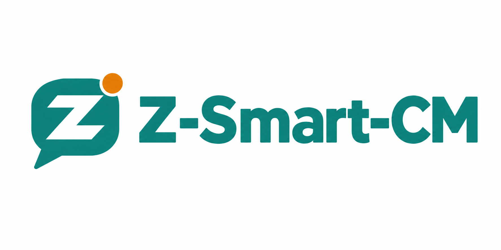

# Z-Smart-CM

<p align="center">
  
</p>

<p align="center">
  <strong>A smart escalation assistant for community managers</strong><br/>
  Handle customer chats escalated from chatbots on Facebook Messenger & WhatsApp.
</p>

<p align="center">
  
  
  
  
  
</p>

---

## ✨ Features

| Feature | Description |
|---------|-------------|
| **Unified Inbox** | All escalated conversations from Facebook & WhatsApp in one list |
| **Real-time Push** | FCM notifications for new escalations (works in background/killed state) |
| **Smart Chat UI** | Per-message RTL/LTR detection for Arabic (darija), French, and mixed text |
| **Three Roles** | Customer (left), Bot (right, labeled), CM replies (teal, right) — visually distinct |
| **Handoff Control** | "Rendre au bot" returns the conversation to the chatbot with confirmation |
| **Offline-First** | Cached auth token, auto-reconnect, optimistic UI with error recovery |
| **Dark Mode** | Complete Material 3 light/dark themes with warm paper surfaces |
| **Demo Mode** | Run in browser with fake data: `flutter run -d chrome --dart-define=DEMO=true` |
| **Accessibility** | 4.5:1 contrast, 48dp touch targets, Semantics labels, 200% text scale, reduced motion |
| **i18n Ready** | French UI (primary), English & Spanish scaffolding via ARB files |

---

## 🎬 Animations & Motion

The app follows a **meaningful motion** system — every animation serves a purpose, respects `MediaQuery.disableAnimations`, and never delays critical actions (alerts, replies, handoffs).

| Screen | Animation | Duration | Easing | Purpose |
|--------|-----------|----------|--------|---------|
| **Splash** | Icon scale `0.8 → 1.0` | 600ms | `easeOutBack` | Playful brand entrance |
| | Wordmark slide up + fade | 300ms | `easeOutCubic` | Staggered reveal |
| | Thin teal progress line | indeterminate | linear | Auth loading feedback |
| **Login** | Hero panel gradient | static | — | Brand presence |
| | Form card entrance | 200ms | `easeOutCubic` | Focus on task |
| | Button spinner (20dp) | — | — | Loading state without label loss |
| **Alert List** | New row: fade + slide up 8dp | 200ms | `easeOutCubic` | Draw attention to fresh escalations (first 8 only) |
| | Haptic on new alert | — | — | `HapticFeedback.lightImpact` |
| **Chat** | New bubble: slide up 8dp + fade | 200ms | `easeOutCubic` | Smooth message arrival |
| | Haptic on send | — | — | Tactile confirmation |
| | Scroll-to-latest button | 150ms | `easeOutCubic` | Appears when scrolled up |
| **Transitions** | Page fade-forward | 200ms | `easeOutCubic` | Consistent navigation feel |
| **Reduced Motion** | All animations disabled | 0ms | — | Instant state changes, no delays |

> **Design principle**: Animations are *outcomes*, not obstacles. A new alert always appears instantly; the motion only enhances the "newness" feeling. The 1-second minimum hold on splash is skipped when animations are off.

---

## 🏗 Architecture

```
lib/
├── api/              # CmApi client (n8n webhook), models, exceptions
├── app/              # Theme, router, strings, root App widget
├── auth/             # AuthBloc, token storage, login flow
├── chat/             # ChatBloc, chat screen, bubbles, composer
├── escalations/      # EscalationsBloc, list screen, cards, sections
├── push/             # PushService (FCM + noop), platform channels
├── demo/             # FakeCmApi, kDemo flag (tree-shaken in prod)
├── l10n/             # ARB files + generated localizations
├── bootstrap.dart    # App initialization (Firebase, BlocObserver)
└── main_*.dart       # Flavor entry points
```

**State Management**: BLoC (`flutter_bloc`) — each feature has its own bloc  
**Navigation**: `go_router` with auth-aware redirects and push deep-links  
**DI**: `RepositoryProvider` — real implementations in `bootstrap.dart`, fakes in tests/demo  
**Theming**: Single source of truth in `lib/app/theme.dart` — zero hex literals elsewhere  

---

## 🎨 Design System

### Brand Colors
| Role | Light | Dark |
|------|-------|------|
| **Primary (Teal)** | `#0F766E` | `#2DB1A5` |
| **Primary Container** | `#D3EEEA` | `#0F3F3A` |
| **Accent (Amber)** | `#D97706` | `#F3C06B` |
| **Surface (Warm Paper)** | `#FAF8F3` | `#0D1412` |
| **Card Surface** | `#FFFFFF` | `#151F1C` |
| **Outline (Hairlines)** | `#E4DFD0` | `#2C3A35` |
| **Ink (Text)** | `#1C2622` | `#E7E3D8` |

### Channel Colors (never themed)
- **Facebook**: `#1877F2` with black text (contrast 4.96:1)
- **WhatsApp**: `#25D366` with `#0B3D20` text (contrast 6.22:1)

### Typography
- **Font**: IBM Plex Sans Arabic (SIL OFL 1.1) — single font for Arabic & Latin
- **Weights**: 400, 500, 600, 700 bundled in `assets/fonts/Plex/`
- **Key styles**: `headlineMedium` (28sp, w700, -0.3 letter-spacing), `bodyLarge` (16sp, height 1.55)

### Shape & Elevation
| Component | Radius | Border | Elevation |
|-----------|--------|--------|-----------|
| Chip | 12dp | 1px outlineVariant | 0 |
| Button | 16dp | 1px outlineVariant | 0 |
| Card | 20dp | 1px outlineVariant | 0 |
| Hero / Dialog / BottomSheet | 28dp | 1px outlineVariant | 0 |
| Bubble | 20dp | 1px outlineVariant (customer) | 0 |
| Floating Bar (Composer) | 24dp | 1px outlineVariant | 2 (blur 16) |

> **No shadows on cards** — only hairline borders. Shadows reserved for floating bars.

---

## 📱 Screens

### Splash
White background with soft teal radial wash (4–8% opacity) at bottom edge.  
Animated icon → wordmark stagger. Thin 3dp teal progress line during auth.  
Footer: hairline + "Développé par" + Microzed logo + name.

### Login
Hero panel: teal→deep-teal gradient, radius 28dp, icon on white plate (100dp).  
Form in outlined Card (radius 20dp, 1px border). Filled inputs (56dp) with prefix icons, show/hide password.  
Inline error box with icon. Primary button 52dp with 20dp spinner.  
Footer: hairline + Microzed credit.

### Alert List (Home)
Two sections: **Ouvertes** / **Fermées** with amber bar (4×18dp), title, count.  
Cards: radius 20dp, outlined, 16/12 padding, 8dp gap.  
- 44dp tonal avatar with initials
- Channel badge in corner (real FB/WA colors, radius 8dp)
- Open: 4dp amber start border + 10dp amber dot
- Closed: muted, `onSurfaceVariant`
- Time pill: radius 20dp, amber when <15min old

Empty state: 96dp tonal circle + icon + title + subtitle.  
Loading: 3 skeleton cards. Error: icon + text + retry button.  
Logout: icon button with tooltip & Semantics label.

### Chat
Header: customer name (RTL for Arabic), channel badge, reason.  
Reason: collapsible amber card (radius 16dp) with flag icon + "Motif".  
Bubbles radius 20dp:
- **Customer**: `surfaceContainer` + 1px border, left
- **Bot**: `surfaceContainerHigh` + "Bot" label, right
- **CM**: solid teal + white text, right

**Per-message text direction**: detects first strong letter (Arabic/Hebrew = RTL).  
Composer: floating bar (radius 24dp, elevation 2), multi-line field, 48dp teal send button.  
"Rendre au bot" in app bar (icon button) → confirmation dialog (radius 28dp).  
Bot active: tonal card with robot icon replacing composer.

---

## 🔧 Flavors

| Flavor | Application ID | App Name | API Base URL |
|--------|----------------|----------|--------------|
| **development** | `tn.microzed.cm_app.dev` | Z-Smart-CM [DEV] | `--dart-define=CM_API_URL=...` |
| **staging** | `tn.microzed.cm_app.stg` | Z-Smart-CM [STG] | `--dart-define=CM_API_URL=...` |
| **production** | `tn.microzed.cm_app` | Z-Smart-CM | `https://n8ntest.microzed.tn/webhook/cm-app` |

Run a flavor:
```bash
# Development
flutter run --flavor development --target lib/main_development.dart

# Staging
flutter run --flavor staging --target lib/main_staging.dart

# Production
flutter run --flavor production --target lib/main_production.dart
```

> The API URL is configurable via `--dart-define=CM_API_URL=<url>` at build/run time.

---

## 🔌 Backend (n8n)

The app talks to a **single n8n webhook** at `https://n8ntest.microzed.tn/webhook/cm-app` with action-based payloads:

| Action | Payload | Response |
|--------|---------|----------|
| `login` | `{username, password}` | `{token, username, expiresAt}` |
| `escalations` | — | `{items: Escalation[]}` |
| `chat` | `{sender_id, platform}` | `Chat` (messages, mode, reason) |
| `reply` | `{sender_id, platform, text}` | 200 OK |
| `give_back` | `{sender_id, platform}` | 200 OK (closes escalation) |
| `logout` | — | 200 OK |

**Auth**: Bearer token in `Authorization` header (stored in `flutter_secure_storage`).  
**401 handling**: Auto-logout, redirect to login.  
**502 `send_failed`**: Surfaces as `SendFailedException` with server detail.

The n8n folder contains:
- `vitrine_cm_app.workflow.json` — Public landing page at `/webhook/z-smart-cm`
- `apk-download.workflow.json` — Serves APK from n8n server disk
- `push_pages.py` — Deploys both workflows via n8n API
- `cm_app_users` table — SHA-256(`username:password`) for agent auth

---

## 🚀 Getting Started

### Prerequisites
- Flutter SDK 3.24+ (Dart 3.5+)
- Android Studio / Xcode for mobile
- Chrome for web preview
- **Optional**: `google-services.json` in `android/app/` for FCM push

### Install & Run
```bash
# Get dependencies
flutter pub get

# Generate localizations & icons
flutter gen-l10n --arb-dir="lib/l10n/arb"
flutter pub run flutter_launcher_icons:main

# Run development flavor
flutter run --flavor development --target lib/main_development.dart
```

### Browser Preview (No Android SDK Needed)
```bash
flutter run -d chrome --target lib/main_development.dart --dart-define=DEMO=true
```
Login: `demo` / `demo` — shows `MODE DÉMO` banner.  
Fake data: 5 escalations (WhatsApp with Tunisian darija, Facebook in French).  
New open escalation appears at 25s. Reply containing `fail` triggers send error.

---

## 🧪 Testing

```bash
# Run all tests with coverage (Very Good CLI)
very_good test --coverage --test-randomize-ordering-seed random

# View coverage report
genhtml coverage/lcov.info -o coverage/
open coverage/index.html
```

Test structure:
```
test/
├── api/           # CmApi contract tests
├── auth/          # AuthBloc, token store
├── chat/          # ChatBloc, message logic
├── escalations/   # EscalationsBloc, list logic
├── helpers/       # Test utilities, fakes
└── push/          # PushService behavior
```

> Test cap: ≤10 tests (currently 9). No new tests unless a pure function needs it.

### Linting
```bash
# Very Good Analysis (very_good_analysis)
flutter analyze

# Bloc-specific lints
dart run bloc_tools:bloc lint .
```

### Formatting
```bash
dart format --set-exit-if-changed lib test
```

---

## 📦 CI/CD

`.github/workflows/release.yml` — On every tag `v*` (e.g., `git tag v0.2.0 && git push --tags`):
1. Builds production APK (`flutter build apk --flavor production`)
2. Creates a **pre-release** on GitHub with the APK attached

⚠️ **Without `google-services.json`** (added as GitHub secret or committed), the CI APK runs **without FCM push** — app works, no notifications.

To publish a fresh APK to n8n download page:
```bash
# 1. Download APK from GitHub Releases
# 2. Copy to n8n server
docker cp app-production-release.apk n8n:/data/apk/Z-Smart-CM.apk
# 3. Activate apk-download workflow in n8n
```

---

## 🌐 Localization

| Locale | File | Status |
|--------|------|--------|
| English (base) | `lib/l10n/arb/app_en.arb` | Scaffold only |
| Spanish | `lib/l10n/arb/app_es.arb` | Scaffold only |
| French (UI) | `lib/app/strings.dart` | **Complete** |

French is the primary UI language — all strings in `Strings` class.  
To add a locale:
1. Create `lib/l10n/arb/app_<locale>.arb`
2. Run `flutter gen-l10n --arb-dir="lib/l10n/arb"`
3. Update `ios/Runner/Info.plist` `CFBundleLocalizations` array

---

## 🔐 Security Notes

- **Token storage**: `flutter_secure_storage` (AES-256, Keychain/Keystore backed)
- **Password hashing**: n8n stores SHA-256(`username:password`) — never plain text
- **Network**: HTTPS only, 15s timeout, certificate validation enforced
- **Push**: FCM data messages only — no sensitive data in notifications

> **2026-11-03**: Fixed plaintext password in `cm_app_users` table. All hashes recalculated.

---

## 📄 License

MIT License — see [LICENSE](LICENSE).

---

## 🙏 Credits

| Asset | Source |
|-------|--------|
| **App Icon** | `assets/logo/icon_1024.png` — generated from prompt in `docs/LOGO_PROMPT.md` |
| **Wordmark** | `assets/logo/wordmark.png` — horizontal lockup |
| **Microzed Logo** | `assets/logo/microzed.jpeg` — "Développé par Microzed" |
| **Font** | IBM Plex Sans Arabic (SIL OFL 1.1) — `assets/fonts/Plex/`, license at `assets/fonts/OFL.txt` |
| **Design Inspiration** | Rattil Quran app (calm, warm, Arabic-first polish) |

---

## 📸 Screenshots

<p align="center">
  
  
</p>

> Add device screenshots here: `docs/screenshots/` (splash, login, alert list, chat light/dark)

---

## 🔗 Links

- **n8n Vitrine (Landing Page)**: https://n8ntest.microzed.tn/webhook/z-smart-cm
- **APK Download**: https://n8ntest.microzed.tn/webhook/z-smart-cm-download
- **GitHub Releases**: https://github.com/zarsalene/cm-app/releases
- **Design Spec**: `docs/DESIGN.md`
- **Logo Prompts**: `docs/LOGO_PROMPT.md`